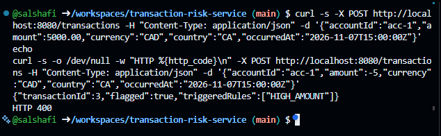
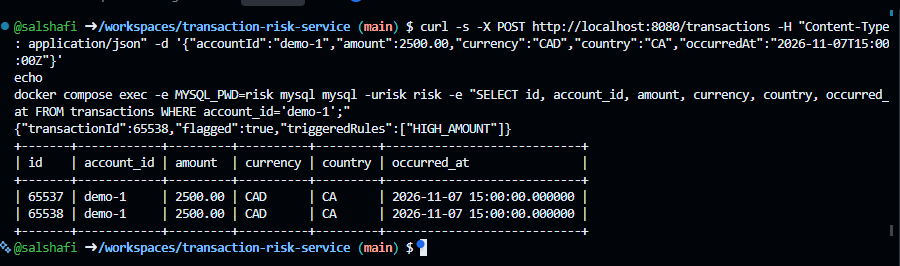
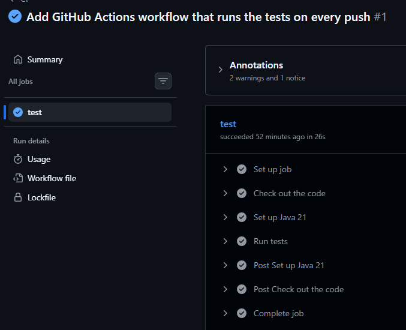
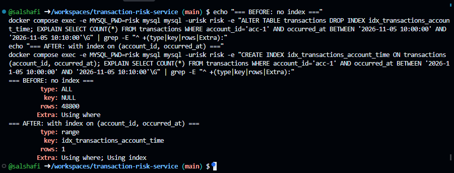

# transaction-risk-service


A small REST API that scores a financial transaction against risk rules and returns whether it should be flagged. Built with Java and Spring Boot, backed by MySQL.

## What it does

`POST /transactions` saves the transaction, runs every risk rule against it, and returns the result:

| Rule | Triggers when |
|------|---------------|
| `HIGH_AMOUNT` | the amount is over 1000.00 |
| `HIGH_VELOCITY` | the account has more than 5 transactions in a 10-minute window |

Example request and response:

```bash
curl -X POST http://localhost:8080/transactions \
  -H "Content-Type: application/json" \
  -d '{"accountId":"acc-1","amount":5000.00,"currency":"CAD","country":"CA","occurredAt":"2026-11-07T15:00:00Z"}'
```

```json
{"transactionId":1,"flagged":true,"triggeredRules":["HIGH_AMOUNT"]}
```

Invalid input (for example a negative amount or a missing field) returns HTTP 400.



## Tech stack

Java 21, Spring Boot, Spring Data JPA (Hibernate), MySQL 8.4, H2 (in-memory, for tests and the default profile), JUnit, Maven, Docker Compose, GitHub Actions.

## Design

- **Layers:** controller → service → repository → entity, each with one job.
- **Rules:** each rule implements a small `RiskRule` interface, so a new rule is one new class that the service picks up in its rule list.
- **Money and time:** `BigDecimal` for amounts and `Instant` for timestamps.
- **Validation:** request fields are checked with Jakarta Validation before any logic runs.

## Run it

Requires JDK 21 or newer.

**Quick start (in-memory H2, no database setup):**

```bash
./mvnw spring-boot:run
```

**With MySQL:**

```bash
docker compose up -d
./mvnw spring-boot:run -Dspring-boot.run.profiles=mysql
```

The API listens on port 8080. With the MySQL profile, each assessed transaction is stored in the `transactions` table:



## Tests

```bash
./mvnw test
```

15 tests cover the rules, the service, the repository, and request validation. GitHub Actions runs them on every push.



## Query performance

The velocity rule counts one account's transactions inside a time window, so the `transactions` table has a composite index on `(account_id, occurred_at)`: the equality column first, the range column second.

I measured it with `EXPLAIN` on 50,000 seeded rows (`scripts/seed-transactions.sql`):

| | Access type | Rows examined (estimate) |
|---|---|---|
| Before the index | `ALL` (full table scan) | 48,800 |
| After the index | `range`, `Using index` | 1 |

The index is declared on the entity, so Hibernate creates it automatically.

